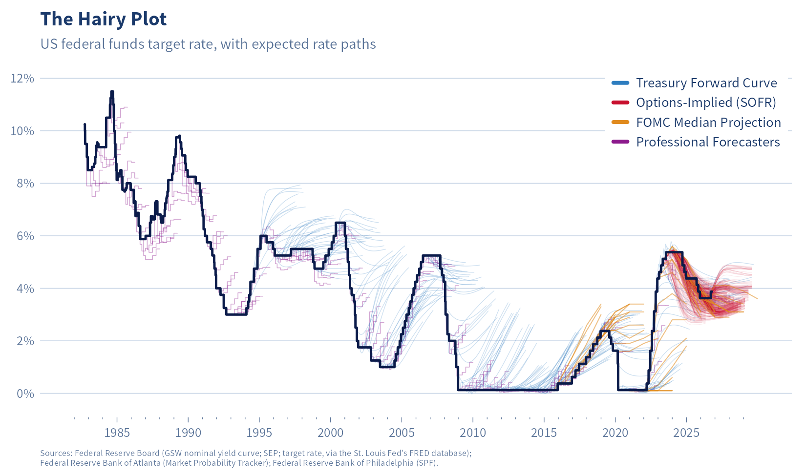{fig-alt="The hairy plot: the US federal funds target rate since 1982 as a heavy line, with thin lines branching off it for the rate paths expected at each past date, from four sources."}

## What Is a Hairy Chart?

A hairy chart shows a metric over time, with forecasts branching off at different points. You might also hear it called a porcupine plot, hairy caterpillar chart, Medusa or Fishhook (for dealing with revised instead of forecast data), or probably the most accurate, *bitemporal charts*.

The central line, or *trunk* or *head*, typically tracks an important metric that people want to forecast frequently and accurately. Each *hair* represents a forecast made at a particular point in time, showing how someone expected that metric to evolve. These forecasts might come from individual predictions, surveys of experts, securities/market prices, or sophisticated statistical models.

There's something funny about looking at all those hairs. Each one represents a moment when some very smart people, perhaps backed by billions of dollars in market bets or enormous computing power & fancy models, stopped and said, "Okay, here's what we think is going to happen." And yet, as you'll see, in many settings they manage to get it wrong with remarkable consistency.

---

### Hairy Plots in the Wild

<!-- The site's thumbnail gallery and lightbox (posts/005-pct-2025 uses the
     same script). Click a thumbnail to enlarge it; the caption comes from the
     matching item in the hidden list below. Outside the website the script
     404s and the images simply show one after another. -->

::: {.photo-gallery data-captions="#wild-sources"}

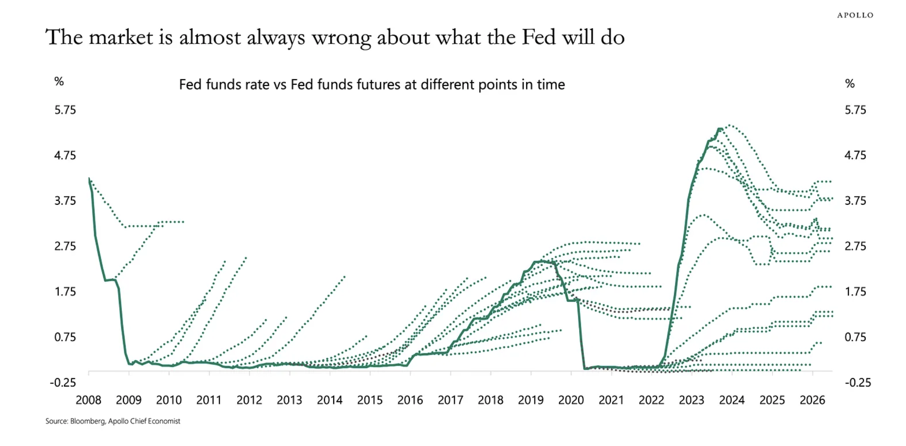

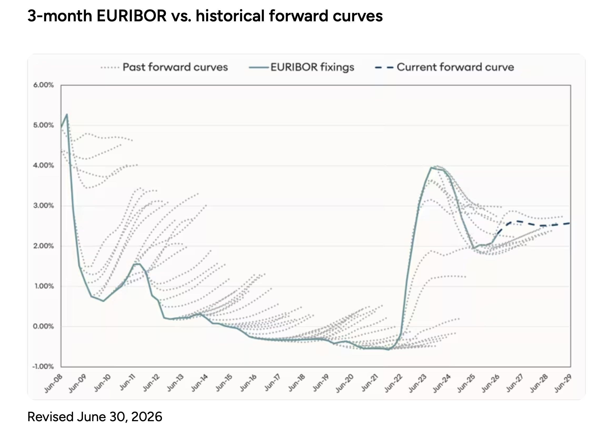

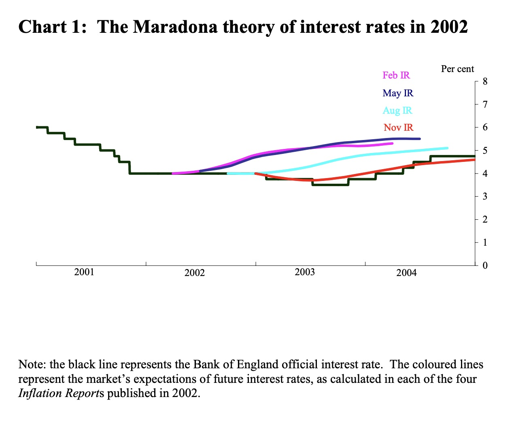
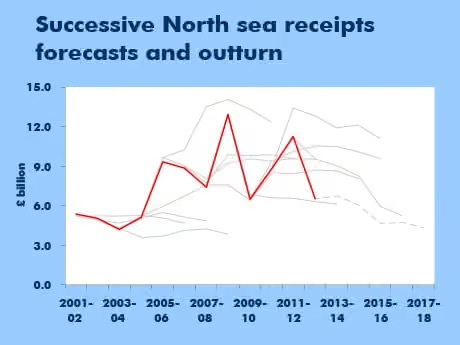
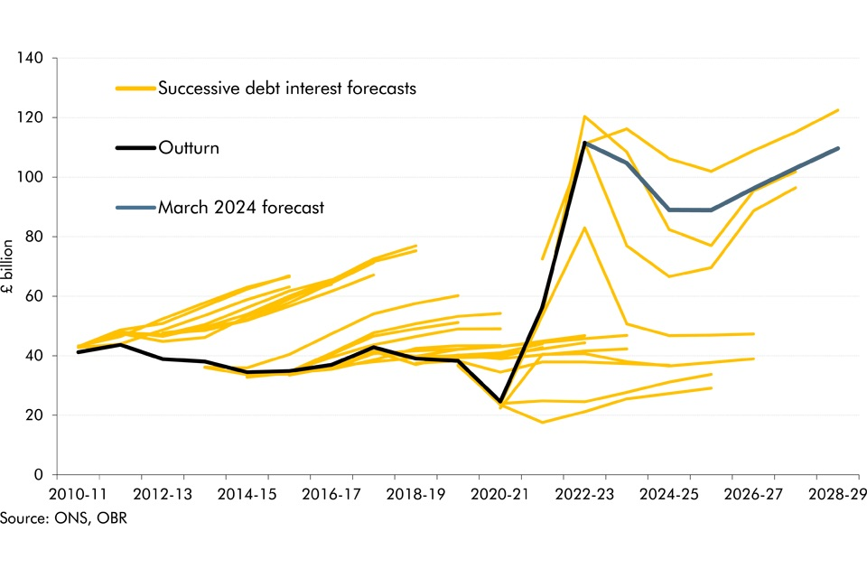
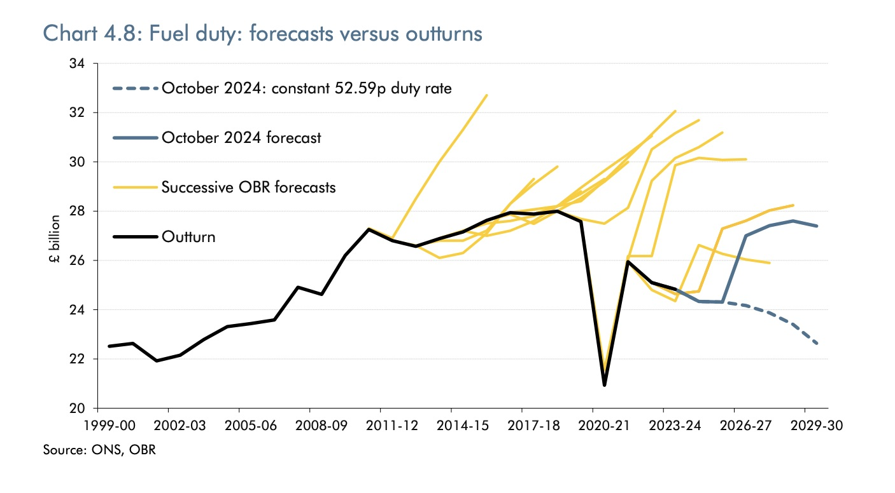
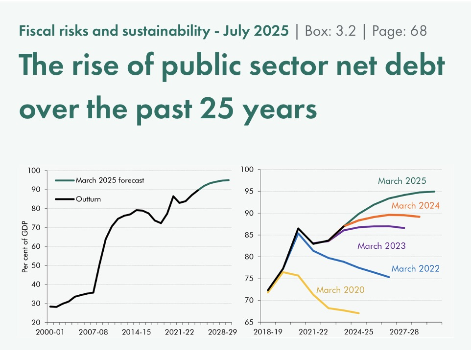
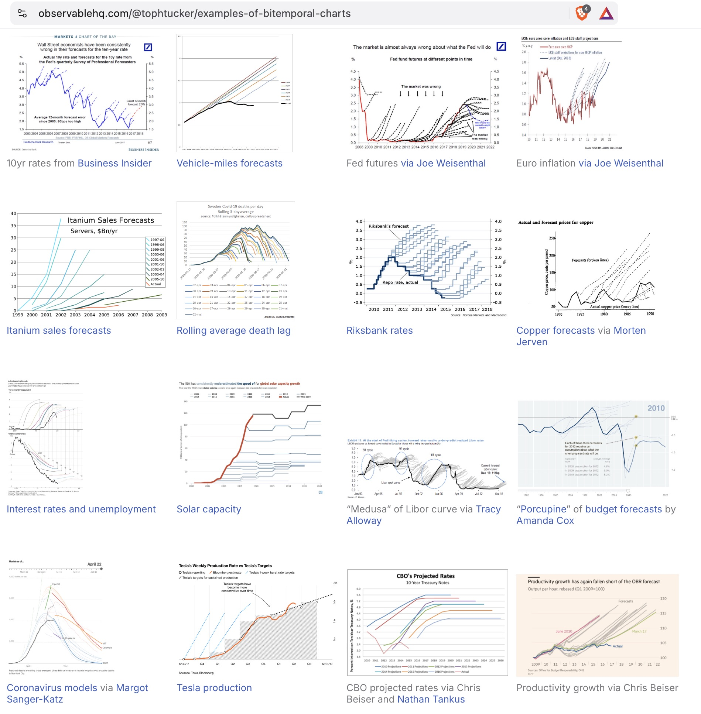
:::

<!-- Lightbox captions, one item per thumbnail above, in the same order. Hidden
     on the page; the lightbox shows each item under its enlarged image. -->
::: {#wild-sources hidden="hidden"}
- **The Economist, January 2024**\
  Shows: the US federal funds target rate since 2008, with the paths markets expected it to take.\
  Data source: Apollo Global Management; Bloomberg.\
  Image source: The Economist, "[Investors may be getting the Federal Reserve wrong, again](https://www.economist.com/finance-and-economics/2024/01/24/investors-may-be-getting-the-federal-reserve-wrong-again)", 24 January 2024.
- **The Economist, "A hairy business", January 2024**\
  Shows: the same chart as it ran inside the article: the federal funds target rate since 2008 and market expectations.\
  Data source: Apollo Global Management; Bloomberg.\
  Image source: The Economist, "[Investors may be getting the Federal Reserve wrong, again](https://www.economist.com/finance-and-economics/2024/01/24/investors-may-be-getting-the-federal-reserve-wrong-again)", print edition of 27 January 2024.
- **Apollo, October 2023**\
  Shows: the fed funds rate since 2008 against fed funds futures at different points in time.\
  Data source: Bloomberg, Apollo Chief Economist.\
  Image source: Torsten Slok, "[Incorrect Fed Expectations](https://www.apolloacademy.com/incorrect-fed-expectations/)", The Daily Spark, Apollo, 27 October 2023.
- **Apollo, reposted November 2023**\
  Shows: the same Apollo chart.\
  Data source: Bloomberg, Apollo Chief Economist.\
  Image source: Liberty's Highlights, "[#456: Hairy Charts & Moore's Law](https://www.libertyrpf.com/p/456-hairy-charts-and-moores-law-david)", 1 November 2023.
- **Chatham Financial, June 2026**\
  Shows: 3-month EURIBOR fixings since 2008 against past forward curves, and the current forward curve to 2029.\
  Data source: not stated on the chart.\
  Image source: Chatham Financial, "[Hairy charts: the accuracy of SOFR, SONIA, and EURIBOR vs. historical LIBOR forward curves](https://cf.com/insights/hairy-charts-accuracy-sofr-sonia-euribor-historical-libor-forward-curves)", revised 30 June 2026.
- **BofA Global Research**\
  Shows: the effective fed funds rate from 2006, with fed funds futures pricing and FOMC forecasts, titled "A long, sordid history of overestimating inflation".\
  Data source: BofA Research Investment Committee, Bloomberg.\
  Image source: original is unknown.
- **J.P. Morgan**\
  Shows: the effective federal funds rate since 1996 (one-month moving average) against one-month OIS forward curves, titled "In late 2018, the market expected the Fed to hike but was caught off-sides".\
  Data source: J.P. Morgan.\
  Image source: original is unknown.
- **Bank of England, May 2005**\
  Shows: Bank Rate from 2001 to 2004 against the market's expected path in each of the Bank's four 2002 Inflation Reports. Titled "The Maradona theory of interest rates in 2002": King's point was that when markets expect the Bank to act, those expectations do much of the work, so rates themselves move less than expected.\
  Data source: Bank of England.\
  Image source: Mervyn King, "[Monetary Policy: Practice Ahead of Theory](https://www.bankofengland.co.uk/-/media/boe/files/speech/2005/monetary-policy-practice-ahead-of-theory)", Mais Lecture, Cass Business School, London, 17 May 2005.
- **The Guardian, May 2013**\
  Shows: UK North Sea oil and gas tax receipts, 2001-02 to 2012-13, against successive forecasts, in £ billion. The article describes Robert Chote, then head of the Office for Budget Responsibility, showing charts like this at a Holyrood seminar.\
  Data source: not stated on the chart.\
  Image source: Severin Carrell, "[Denis Healey, Scottish independence and the black, black oil](https://www.theguardian.com/politics/scottish-independence-blog/2013/may/29/scottish-independence-oil-healey)", The Guardian, 29 May 2013.
- **UK Office for Budget Responsibility, March 2024**\
  Shows: UK debt interest spending since 2010-11 against successive OBR forecasts and the March 2024 forecast, in £ billion.\
  Data source: ONS, OBR.\
  Image source: OBR, "[The sensitivity and volatility of debt interest spending](https://obr.uk/box/the-sensitivity-and-volatility-of-debt-interest-spending/)", Box 4.3, Economic and fiscal outlook, March 2024.
- **UK Office for Budget Responsibility, October 2024**\
  Shows: UK fuel duty receipts since 1999-00 against successive OBR forecasts, the October 2024 forecast, and a path with the duty rate held at 52.59p, in £ billion.\
  Data source: ONS, OBR.\
  Image source: OBR, Chart 4.8, "Fuel duty: forecasts versus outturns", in the [Economic and fiscal outlook, October 2024](https://obr.uk/docs/dlm_uploads/OBR_Economic_and_fiscal_outlook_Oct_2024.pdf).
- **UK Office for Budget Responsibility, July 2025**\
  Shows: UK public sector net debt since 2000-01 as a share of GDP, and the forecasts of March 2020 to March 2025, each ending higher than the one before.\
  Data source: not stated on the image.\
  Image source: OBR, "[The rise of public sector net debt over the past 25 years](https://obr.uk/box/the-rise-of-public-sector-net-debt-over-the-past-25-years/)", Box 3.2, Fiscal risks and sustainability, July 2025.
- **Toph Tucker, Observable**\
  Shows: 16 of the 40-odd examples Tucker has collected, from Fed futures and Riksbank rates to Itanium sales, Covid models and Tesla production, including a "Porcupine" of budget forecasts by Amanda Cox and a "Medusa" of Libor curves via Tracy Alloway. He calls them bitemporal charts: plots of data with two dates, when a number was made and what date it is about.\
  Data source: various, credited in the notebook.\
  Image source: Toph Tucker, "[Examples of bitemporal charts](https://observablehq.com/@tophtucker/examples-of-bitemporal-charts)", Observable.
:::

### Why Hairy Charts Are Interesting

For starters, so many of these plots you see in the wild really drive home how badly we forecast metrics that matter a lot to us.

Take the federal funds rate. There are plenty of ways to forecast it. You can survey experts, including Fed officials and professional forecasters, or infer market expectations from interest rate futures, options, and other financial instruments. And there's plenty of incentive to get it right. This one rate influences borrowing costs across the economy, investment decisions, asset prices, the cost of financing the US government’s debt and so much more. 

Given how much goes into forecasting it, you might expect the predictions to be pretty good. Historically, though, they've been pretty poor.

And not just a little wrong. Often wrong in the same direction for years. For example, from 2009 until the Fed finally raised rates in December 2015, forecasts repeatedly anticipated an earlier increase. Have a look at the plot: more often than not, they’re wrong.

There are several possible explanations. Forecasters tend to expect rates to return to familiar levels. Market-implied rates aren’t pure expectations: the Treasury forward curve includes a term premium, and options-implied SOFR is risk-neutral, which builds in a risk premium (both covered below). Markets also take cues from the Fed's own guidance, so the Fed and market participants can end up making similar mistakes (several plots from the wild above show both). And, of course, some of the biggest changes in interest rates are responses to shocks that nobody saw coming.

### But Sometimes They Get It Right  

The forecasts aren't always wrong. For example, the Fed’s median projection from June 2023 turned out to be close, as did market expectations implied by SOFR options in September 2023. But accuracy tends to deteriorate with the forecast horizon.

 
::: {.photo-gallery .gallery-pair data-captions="#good-forecasts"}
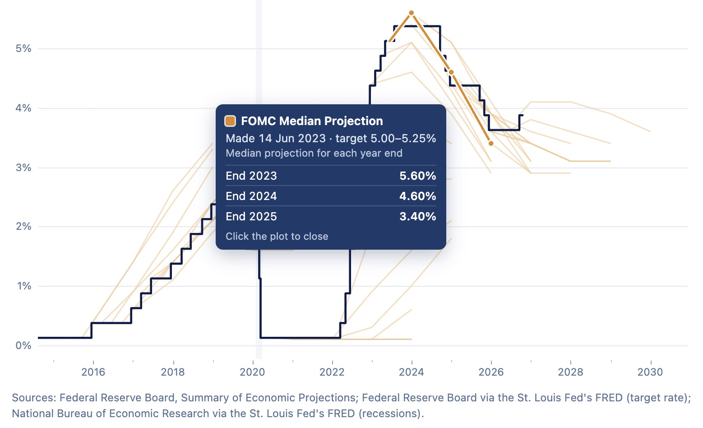
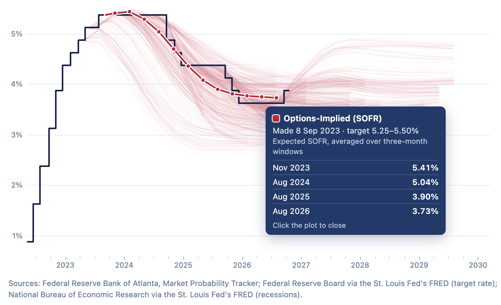
:::

::: {#good-forecasts hidden="hidden"}
- **FOMC median projection, 14 June 2023**\
  Projected the target rate at 5.6% for the end of 2023, 4.6% for 2024 and 3.4% for 2025. It ended those years at 5.375%, 4.375% and 3.625%, within about a quarter point each time.\
  A screenshot from the [interactive version](interactive/index.qmd).
- **Options-implied SOFR, 8 September 2023**\
  Options on SOFR futures priced rates holding near 5.4% into 2024, then easing to about 3.9% by August 2025 and 3.7% by August 2026. They expected cuts a little early, missing by under a tenth of a point on average and about half a point at most.\
  A screenshot from the [interactive version](interactive/index.qmd).
:::

::: {.pair-caption}
Two forecasts that held up: the FOMC's median projection from June 2023 (left) and the options-implied path from September 2023 (right). Screenshots from the interactive; click or tap either to enlarge.
:::

And, quite apart from what they tell us about forecasting, I think hairy charts just look pretty cool.

## Interact with the Fed Funds Hairy Plot

[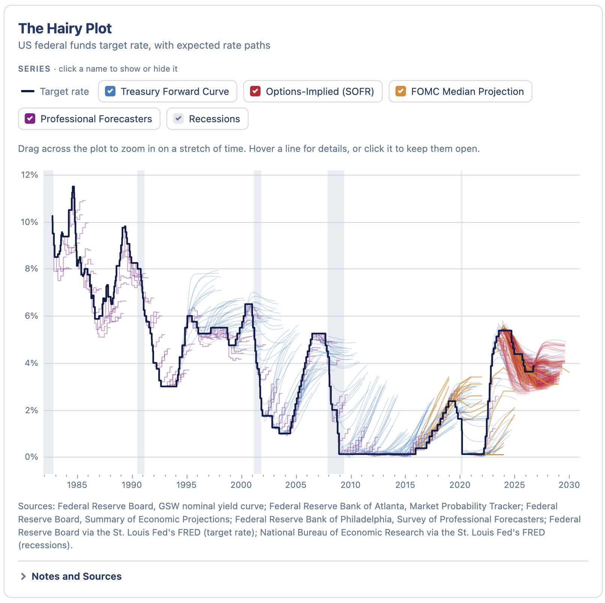{fig-alt="Screenshot of the interactive hairy plot."}](interactive/index.qmd)

Here's an [interactive version](interactive/index.qmd) of the hairy plot for the fed funds rate.  Zoom into any stretch of years, show or hide each series and recession shading, and hover over or tap any hair to see the forecast it made. I get into the four forecast series below.

## How to Make the Hairy Chart

### Two Dates for Every Number

A hairy plot needs data with two dates on every number: the date it was made, and the date it is about. (I like [Toph Tucker bitemporal chart article on ObservableHD](https://observablehq.com/@tophtucker/examples-of-bitemporal-charts), it's a good tour of the idea.)

Take one hair. On 16 March 2022, the FOMC raised its target range to 0.25% to 0.50%, its first increase since 2018, and published its participants’ projections for the federal funds rate at the end of 2022, 2023 and 2024. The medians, all made that day, each about a different date:

| Forecast Made On        | Forecast About       | Projected rate | Actual rate |
|-------------|-------------|---------------:|------------:|
| 16 Mar 2022 | 31 Dec 2022 |          1.90% |      4.375% |
| 16 Mar 2022 | 31 Dec 2023 |          2.80% |      5.375% |
| 16 Mar 2022 | 31 Dec 2024 |          2.80% |      4.375% |

This hair starts on the head at its made date, at the rate set that day (0.375%, the middle of the new range), and runs through the three projections. Every meeting leads to another set of projections, adding another hair.

This hair missed badly: the rate ended 2022 at 4.375%, not 1.9%, and 2023 at 5.375%, not 2.8%.

There are other types of these bitemporal charts. For a policy rate, the outcome is known the day it happens, so the head never moves. Plenty of numbers aren’t like that. GDP, employment and population keep being revised long after the day has passed, so their heads grow hairs of their own.  Lines connect points about the same date; x-axis shows date they’re made on, they connect data made on different dates about the same date. I've seen this called a "fishhook" chart, I think I'd borrow from nautical nomenclature and call them [*telltale plots*](https://en.wikipedia.org/wiki/Tell-tale_(sailing)). 

### Forecasts of the Federal Funds Rate

For the federal funds rate, the head is the FOMC’s target, and the hairs need forecasts made on many days, each about many days ahead. Many of the best-looking hairy plots I’ve seen use fed funds futures and overnight index swap (OIS) curves, which price every upcoming FOMC meeting every trading day. Those come from providers like Bloomberg, and I couldn’t access (afford) them. Fortunately, four free sources have the same two-date shape, each on its own schedule:

- Treasury forward curves: a hair at every FOMC meeting since 1994, cut at three years.
- Options on SOFR futures: a hair every trading day since March 2023, about three years long.
- The FOMC’s median projection: a hair four times a year since September 2015, up to about three years ahead.
- The Survey of Professional Forecasters: a hair every quarter since 1982, about a year long.

I created reproducible notebooks that document how I got and parsed these datasets. The [R notebook](r/index.qmd) and the [Python notebook](python/index.qmd) walk through each one, from loading the data to the final plot. And here's a [repo](https://github.com/EconomiCurtis/hairy-chart) with cleaned data in [`data/`](https://github.com/EconomiCurtis/hairy-chart/tree/main/data), and scripts in [`scripts/`](https://github.com/EconomiCurtis/hairy-chart/tree/main/scripts) that download and build those datasets.

Here's a bit about each series. 

### Federal Funds Target Rate

First, let's set up the "head", every "hair" grows from. 

::: {.callout-note collapse="true"}
## Source Detail: The FOMC Target (click to expand)

The rate the Federal Open Market Committee announces it is aiming for. It was a single number until December 2008, and a quarter-point range since. The New York Fed: "The Federal Open Market Committee establishes the target rate, or range, for trading in the federal funds market."

FRED `DFEDTAR` is the single target, 27 September 1982 to 15 December 2008. `DFEDTARL` and `DFEDTARU` are the lower and upper limits of the range from 16 December 2008, when the Committee cut to 0 to 0.25 percent and has used a range ever since. Verified at the join: `DFEDTAR` ends 2008-12-15 at 1.00, `DFEDTARL`/`DFEDTARU` begin 2008-12-16 at 0.00/0.25.

Values before 1994 are a reconstruction: the FOMC began announcing its target decisions in February 1994, and FRED's series notes say the 1982 to 1993 values come from Thornton (2005), a Federal Reserve Bank of St. Louis working paper.

**Citations.**

- <https://fred.stlouisfed.org/series/DFEDTAR>
- <https://fred.stlouisfed.org/series/DFEDTARU>
- <https://fred.stlouisfed.org/series/DFEDTARL>
- Thornton, Daniel L. (2005), "A New Federal Funds Rate Target Series: September 27, 1982 - December 31, 1993", Federal Reserve Bank of St. Louis
- <https://www.newyorkfed.org/markets/reference-rates/effr>
:::

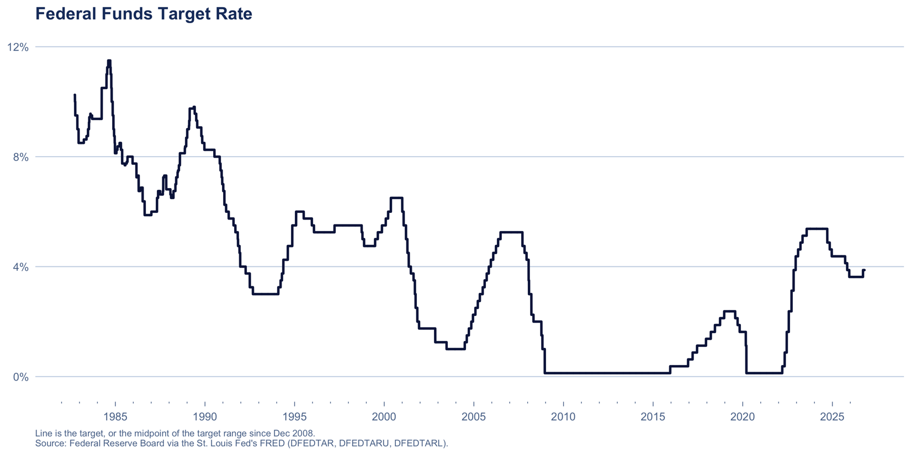{fig-alt="The federal funds target rate since 1982."}

### Treasury Forward Curve

The rate the Treasury bond market implies for each future date, from the yield curve that Federal Reserve Board staff fit every day, taken at each FOMC meeting since 1994.

::: {.callout-note collapse="true"}
## Source Detail: GSW Nominal Yield Curve (click to expand)

What the Treasury bond market implies about future short rates, backed out daily by Federal Reserve Board staff from a smooth curve fitted across the whole maturity spectrum.

The Board describes the dataset as "smoothed yields on hypothetical Treasury securities that can be easily compared across maturities and over time, from 1961 to the present". Its model "stipulates that the shape of the yield curve on any given date can be adequately captured by a set of six parameters", estimated "by minimizing the discrepancy between the fitted Svensson yield curve and observed market yields". Before 1980, "the Nelson-Siegel model—a model with fewer parameters—was used".

On what goes into the fit: "only the coupon securities (Treasury notes and bonds) are used"; "on-the-run and first-off-the-run Treasury notes and bonds are not used"; and "Treasury bills and Treasury floating rate notes (FRNs) are not used".

It is not an official statistic. The Board calls it "a staff research product and not an official statistical release". A forward rate is the expected future short rate *plus a term premium*, so the hairs aren’t a pure expectations path: they can sit a little above or below it. And because bills are excluded and the curve is a six-parameter analytic function, the hairs are smooth by construction: they cannot show the discrete steps at FOMC meetings that market data pricing individual meetings shows.

**Citations.**

- <https://www.federalreserve.gov/data/nominal-yield-curve.htm>
- Gürkaynak, Sack and Wright (2006), FEDS 2006-28, <https://www.federalreserve.gov/pubs/feds/2006/200628/200628pap.pdf>
- Published in *Journal of Monetary Economics* 54(8), 2007, 2291-2304
:::

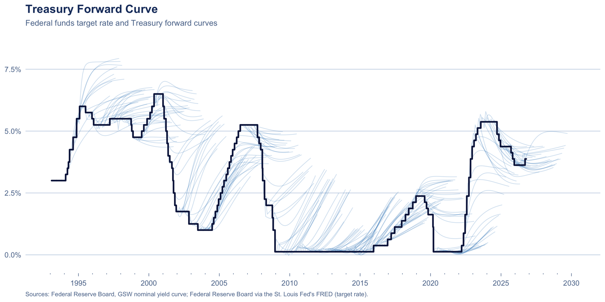{fig-alt="The federal funds target rate with Treasury forward curves branching off it."}

### Options-Implied (SOFR)

What options on SOFR futures imply the overnight rate will average over each coming three-month window, estimated daily by the Federal Reserve Bank of Atlanta since March 2023.

::: {.callout-note collapse="true"}
## Source Detail: Atlanta Fed Market Probability Tracker (click to expand)

What options traders are collectively betting, as a full probability distribution over where the overnight rate will average in a future three-month window.

From the data dictionary shipped inside the file: "The Market Probability Tracker uses Chicago Mercantile Exchange (CME) 3-month SOFR options to estimate the probability ditributions implied by their prices and specified reference window." Their guide adds that it "transforms options on SOFR futures prices into probability distribution values".

Two fields are used. `reference_start` is the "Start date of the 3-month window referenced by CME 3-month SOFR contracts". `Rate: mean` is "The rate, in basis points, associated with the mean of the estimated distribution for a given reference window".

The underlying rate is SOFR, published by the [Federal Reserve Bank of New York](https://www.newyorkfed.org/markets/reference-rates/sofr): a broad measure of the cost of borrowing cash overnight collateralized by US Treasury securities. That makes it a secured rate, where the federal funds rate is unsecured lending between banks; the two are close but not identical. An option-implied distribution is risk-neutral, so it is what traders expect weighted by how much they care about being wrong each way, not literally what they expect. It starts in March 2023.

Each point comes from its own window's option prices rather than from one fitted curve, but as a three-month average weighted across possible outcomes it does not resolve individual FOMC meetings.

**Citations.**

- <https://www.atlantafed.org/research-and-data/data/market-probability-tracker>
- <https://www.atlantafed.org/research-and-data/data/market-probability-tracker/what-to-know>
- <https://www.newyorkfed.org/markets/reference-rates/sofr>
- Estimation code published as `mpt_source.zip` on the tracker page
:::

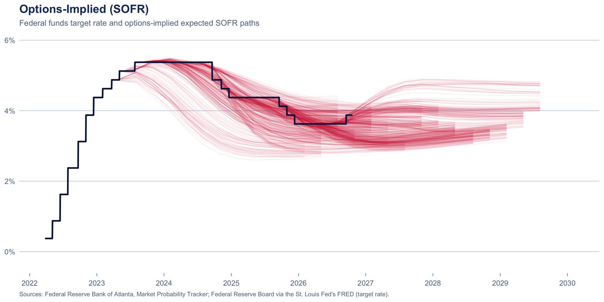{fig-alt="The federal funds target rate with options-implied SOFR paths branching off it."}

### FOMC Median Projection

The median FOMC participant's projection of the federal funds rate at the end of each of the next few years, from the Summary of Economic Projections, published since September 2015.

::: {.callout-note collapse="true"}
## Source Detail: The Summary of Economic Projections (click to expand)

Four times a year each of the Federal Reserve's senior policymakers writes down where they think the federal funds rate should be at the end of each of the next few years. This is the middle answer.

The table is titled "Economic projections of Federal Reserve Board members and Federal Reserve Bank presidents, under their individual assumptions of projected appropriate monetary policy": all 7 Governors plus all 12 Reserve Bank presidents. That is wider than the Committee's voting membership: the Board says the Committee "consists of twelve members", namely "the seven members of the Board of Governors of the Federal Reserve System; the president of the Federal Reserve Bank of New York; and four of the remaining eleven Reserve Bank presidents, who serve one-year terms on a rotating basis". Staff produce a separate forecast, the Tealbook, released only after five years.

From the table notes: "The projections for the federal funds rate are the value of the midpoint of the projected appropriate target range for the federal funds rate or the projected appropriate target level for the federal funds rate at the end of the specified calendar year or over the longer run." And: "For each period, the median is the middle projection when the projections are arranged from lowest to highest."

It is not a forecast. The row is labeled "Memo: Projected appropriate policy path", and projections rest on each participant's "assessment of appropriate monetary policy". Normative, conditional on each person's own outlook, and never voted on.

Only 44 of 59 releases give a median. The median column was introduced with the September 2015 SEP; before that the table shows a central tendency and range only, and the dots exist solely as a figure.

**Citations.**

- `https://www.federalreserve.gov/monetarypolicy/files/fomcprojtabl{YYYYMMDD}.pdf`
- <https://www.federalreserve.gov/monetarypolicy/fomc.htm>
- <https://fred.stlouisfed.org/series/FEDTARMD>
:::

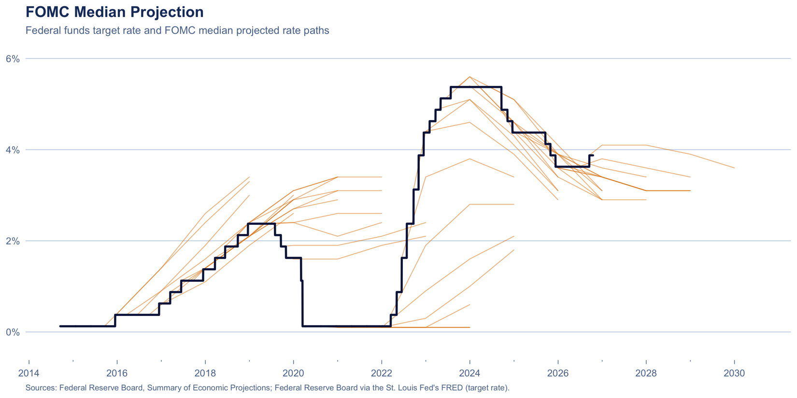{fig-alt="The federal funds target rate with FOMC median projections branching off it."}

### Professional Forecasters

The Philadelphia Fed's quarterly survey: the median forecast of the three-month Treasury bill rate for the current quarter and the next four, back to 1982.

::: {.callout-note collapse="true"}
## Source Detail: Survey of Professional Forecasters (click to expand)

Every quarter the Philadelphia Fed asks a few dozen professional forecasters where the three-month Treasury bill rate will be over the next five quarters, and publishes the median.

The Philadelphia Fed describes it as "the oldest quarterly survey of macroeconomic forecasts in the United States. The survey began in 1968 and was conducted by the American Statistical Association and the National Bureau of Economic Research. The Federal Reserve Bank of Philadelphia took over the survey in 1990." Individual responses are "kept confidential by using identification numbers".

The survey asks about the bill rate, not the federal funds rate, but the two track each other closely: a three-month bill pays roughly what investors expect overnight rates to average over its three months. The bill normally sits a little below fed funds, so a forecast of the bill rate works as a rough forecast of the policy rate that runs slightly low.

**Citations.**

- <https://www.philadelphiafed.org/surveys-and-data/real-time-data-research/survey-of-professional-forecasters>
- Documentation PDF: variable definitions p.10, horizon numbering p.20, survey timing p.7
:::

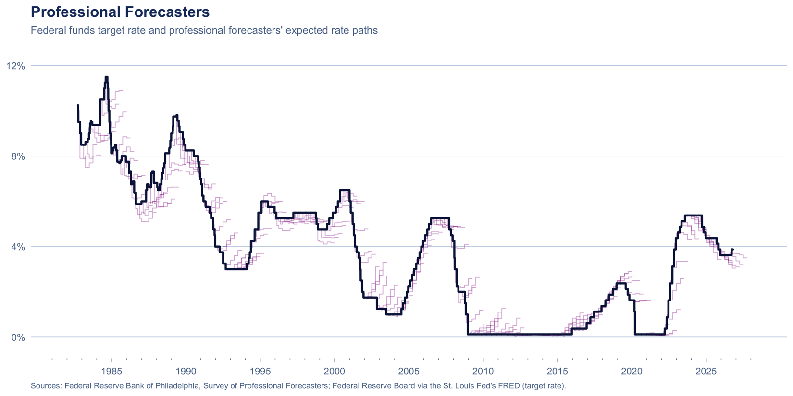{fig-alt="The federal funds target rate with professional forecasters' expected paths branching off it."}

